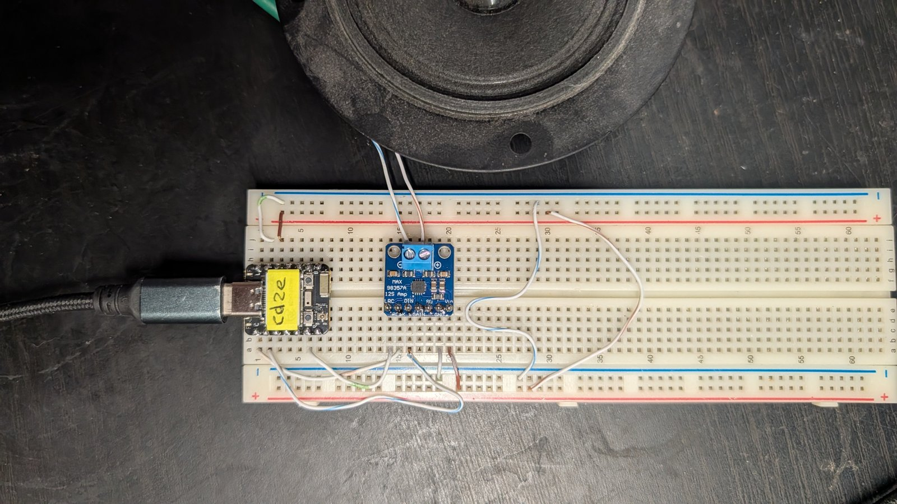

# Hookup: MAX98357A I2S amp on the XIAO nRF54L15 Sense (cd2e)

For on-board speech (#6). Module: `max98357a.png`; bench as wired 2026-11-23: `hookup-breadboard.jpg`; the
bench that runs rung 8 (2026-11-25): `hookup-bench.jpg`, below.

| MAX98357A | XIAO | nRF54L15 | Why |
|---|---|---|---|
| BCLK | D0 | P1.04 | I2S20 is P1-only; SCK must be a dedicated clock pin (datasheet 8.8.5, pin table) |
| DIN | D1 | P1.05 | data next to its clock pin |
| LRC | D5 | P1.11 | the other clock pin on the header; Zephyr's I2S tests use clock pins for LRCK too |
| Vin | 3V3 (as wired) | — | amp takes 2.5–5.5 V; 5V is louder but likely unpowered on battery (unchecked) |
| GND | GND | — | |
| GAIN | open | — | 9 dB |
| SD | open | — | (L+R)/2, suits mono; later to D2 to shut the amp down between phrases |
| speaker | terminal block | — | 4–8 Ω |

Taken on the board: P1.12/P1.13 (PDM mic), P1.08/P1.09 (console UART), P0.03/P0.04 (IMU, `i2c30`). D4/D5 are
Zephyr's default I2C pins but ktau does not use them.

## Status (2026-11-24): works — clean speech heard

Three things were wrong; each fix is in `c/phrasecheck` (the reference) and its overlay.

| Symptom | Cause | Fix |
|---|---|---|
| I2S stalls after one buffer | the board dtsi enables `i2c22` on D4/D5, so TWIM22 owned P1.11 (LRC) | `&i2c22 { status = "disabled"; }` |
| tone and speech poor on some boots, clean on others | the board dtsi sets `clock-source = "PCLK32M"` (internal RC); the amp times everything from BCLK | `clock-source = "PCLK32M_HFXO"` |
| speech poor at 8 kHz even on the crystal (a 440 Hz tone was clean) | not pinned down. At 8 kHz the driver's MCKFREQ is below `I2S_CONFIG_MCKFREQ_MCKFREQ_Min` and nrfx does not check it | run I2S at 16 kHz, each synth sample interpolated once |

- **Evidence, stall:** `c/i2sbare` went from 1 to 51 TXPTRUPD/s on every pin set with only `i2c22` disabled; with
  it enabled, exactly the pin sets with a clock on P1.11 stalled, and the pad read 1 while GPIO drove it 0.
- **Evidence, sound (David's ears, one boot each):** RC clock: 8 kHz tone, 8 kHz speech and 16 kHz speech all poor.
  Crystal: 8 kHz tone clean, 8 kHz speech poor, 16 kHz speech good. Crystal + 16 kHz, all three canned phrases:
  "a little robotic, but quite clean". On the RC clock a 16 kHz tone was ugly once and clean three times.
- Level: 9 dB gain, Vin on 3V3, samples shifted right by `QUIETER`: a good bench volume.
- Not the cause of anything: MCKFREQ at 16 kHz, sample rate (for the stall), input buffers, dedicated clock pins
  (D2/D3 clock I2S fine), the amp.
- The Toit firmware has all three: the first two in `c/speech/speech.overlay`, the third in `c/speech/speech.c`.
- Unexplained: a `Halting system` on the first `tonecheck` boot of the day; and twice a flash completed but the
  board printed nothing until reflashed. A faint "twang" ended each clip on the RC-clock run; not asked about since.
- Logs (git-ignored): `samples/i2sbare-2026-11-24.log`, `samples/tonecheck-2026-11-24.log`,
  `samples/phrasecheck-2026-11-24.log`.
