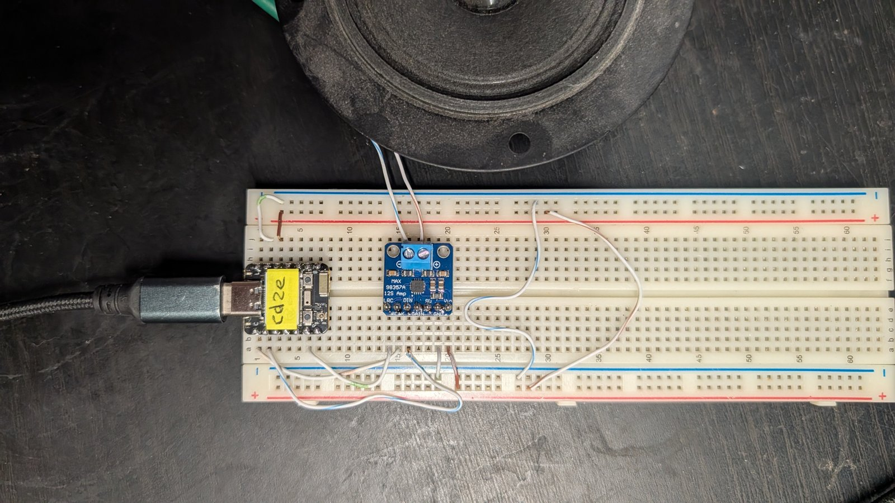

# Push to talk ... to my LLM

*Toit on Zephyr → Thread → LLM, and a spoken answer back*

Draft, 2026-11-25. Raw material: `docs/journal/01`–`08`, and for speech `docs/design/2026-11-23-on-board-speech-sketch.md`.

This is a demonstration: an off-the-shelf Seeed Studio module, the thumb-sized XIAO nRF54L15 Sense, takes a spoken
question, sends it to an LLM inside my home network, and speaks the answer. The board runs
[Toit](https://toitlang.org) on Zephyr, through [ztoit](https://github.com/davidg238/ztoit). It shows two things: how
much of a new board's work can stay in Toit, and how little a small device needs to be sent in order to talk.

Hold the button and ask "what is two plus two?". About a second after you let go, a small speaker
says "two plus two is four". Say "remind me to buy milk" instead, and the LED blinks twice and the note is on a
machine at home. The program on the board is 70 lines of Toit.



The whole device: the XIAO on the left, a MAX98357A I2S amplifier, and a speaker.

## The architecture

The demo stays at home, and needs no phone and no cloud:

- **The board** is a sleepy end device on a [Thread](https://www.threadgroup.org) mesh. It sends UDP to an IPv6
  address and knows nothing else about the network.
- **A Thread border router** on the LAN routes between the mesh and the home network, so the board's datagrams
  reach the receiver at its LAN address, and the reply finds its way back to the board.
- **The receiver** runs Whisper, then asks an LLM (llama.cpp) on the same machine, a desktop with two GPUs on
  the LAN. The LLM is spread over both cards and Whisper has what is left of the smaller one.
- **The answer goes back as phonemes, not audio.** A sleepy Thread device keeps its radio off and asks its parent
  router for waiting data every 100 ms. That measured too slow for an audio stream, and is plenty for one datagram.
  So the server sends what to say, 4 bytes a phoneme, and the board does the speaking itself.

Away from home, a phone can stand in for the mesh: see [the other link](#the-other-link-a-phone-and-a-tailnet)
below. What this does and doesn't protect is set out [further down](#security-what-is-and-isnt-protected).

## The chain

```text
 nRF54L15 │ button      held: LED on, record   │ speaker     LED
 (Toit)   │   ↓                                │   ▲          ▲ 2 short: ok
          │ PDM mic     Zephyr's dmic driver   │ I2S amp      │ 1 long: not
          │   ↓         a block every 100 ms   │   ▲          │
          │ LC3         liblc3: 400 B a block  │ diphone      │
          │   ↓                                │ synth, in C  │
          │ UDP/Thread  sleepy end device      │   ▲          │
──────────┼────────────────────────────────────┼───┼──────────┼───────────
 LAN      │ border      routes mesh ↔ LAN      │   │          │
          │ router                             │   │          │
──────────┼────────────────────────────────────┼───┼──────────┼───────────
 server   │ receiver    reassembles the clip   │   │          │
          │   ↓                                │   │          │
          │ Whisper     speech to text         │   │          │
          │   ↓                                │   │          │
          │ LLM         on the same machine:   │   │          │
          │   ↓         note/say/none          │   │          │
          │ Flite       text to phonemes       │   │          │
          │   ↓                                │   │          │
          │ reply ─────────────────────────────┼───┴──────────┘
          │             status, 4 B a phoneme  │
```

- **The board** sends an END on release, then waits up to 30 s for the reply; no reply is 5 fast blinks.
- **The receiver** is about 300 lines of Python. It evens out the level before Whisper, and the LLM may only pick
  from an allowlist of actions: `note`, `say` or `none`. Whatever it answers in words is spoken, in one sentence of
  at most 15 words.
- **The reply** is one datagram: a status byte for the LED, then the phonemes. "Two plus two is four" is 60 bytes.

At the bench, over Thread: five clips, 273 audio blocks, none lost, the longest question 11.5 s. The reply arrived
0.7–1.0 s after release; Whisper (`small.en`) is 0.2–0.3 s of that and the LLM 0.4–0.5 s. A stray two-block press
answered "no speech". The
longest answer was 70 phonemes, 280 bytes, and took 7.4 s to say.

## What went into C, and what stayed in Toit

The rule for the whole project was: the application stays in Toit, and C gets only what Toit can't reach. Each new
primitive is generic: it would work on another board with the same kind of device.

| Piece | C | Toit |
|---|---|---|
| Microphone | 3 primitives over Zephyr's `dmic` API, ~100 lines | `zephyr.Microphone`, 42 lines |
| LC3 | 2 primitives over liblc3, 54 lines | `zephyr.Lc3Encoder`, 30 lines |
| Speech | 2 primitives, 26 lines; the synthesizer and its player are a Zephyr module in the demo's repo, 381 lines | `zephyr.Speech`, 17 lines |
| Network | none: ztoit already ran Thread | nothing new: `net.open`, `udp-open` |
| Button, LED | none: `gpio-keys` and `led` were already there | `zephyr.Key`, `zephyr.Led` |
| The app | none | 70 lines |

### The microphone: a Zephyr driver, used as it is

The XIAO's microphone is a PDM part, and Zephyr already has a driver behind its generic `dmic` API. So the Toit side
is three small primitives (start with a format and gain, read one block without waiting, stop) and a 42-line
`Microphone` class. They take any `dmic` device by its devicetree label; nothing in them is about this board.

The driver had some edges, and the primitives smooth them over so a Toit program gets an exception, not silence:

- **The first block after a start is the filter settling** (a peak near 15000 in a quiet room). Toit drops it.
- **Falling behind stops the microphone without an error.** When the driver's 4 blocks are full it stops, and
  `dmic_read` simply never returns another block. `read` now throws `MICROPHONE_STOPPED` after a second.
- **Stopping finishes the current block first**, and the driver refuses a new start until then. `start` retries, and
  takes the microphone over from a program that died without stopping it.

Compared with Zephyr's own C sample: 27 lines of Toit against 109 lines of C, no block to free by hand, and the
device chosen at run time rather than fixed at build time.

### LC3

Zephyr ships liblc3 as a module. Two primitives wrap it, and turning on the FPU for it was the main risk: from then on
the whole VM is built for the hardware-float ABI. It linked first time. Encoding takes 12.9 ms per 100 ms block, so
the board spends about 13 % of its time encoding. Through Whisper, the board's one microphone at 32 kbit/s scored the
same as a Bluetooth headset in a quiet room: 5/5 transcripts.

### Speech: a voice in 577 KB

The reply path decided the design. Streaming synthesized audio to the board would need it to listen all the time,
and a compressed sentence is still tens of kilobytes. A sentence as phonemes fits one small datagram, if the board
can turn phonemes into sound. So it carries a voice:

- **The voice** is the CMU "kal" diphone set that ships with [Flite](http://cmuflite.org), whose licence allows
  reuse with its notice: 1584 recorded transitions between pairs of phonemes, 207 s of speech in all.
- **The encoding** is residual-excited LPC at 8 kHz: ten filter coefficients every 10 ms, and the filter's input
  kept at 2 bits a sample. That is 577 KB; Flite stores the same voice in 1245 KB. At 3 bits a sample it sounds a
  little better, but the table grows to 780 KB, and with the rest of the firmware that leaves under 20 KB of the
  board's flash free.
- **The server does the linguistics.** Flite's front end turns the LLM's text into phonemes, each with a duration
  and a pitch. On the wire a phoneme is 4 bytes: which one, how long in ms, how high in Hz.
- **The board does the signal processing:** it joins the diphones, stretches them to the durations, moves the
  pitch and runs the filter, in integer arithmetic. The synthesizer is 259 lines of C and about 3 KB of code,
  checked sample for sample against a Python model on the host. It costs 35 ms of CPU per second of speech.
- **Toit sees two primitives:** say these bytes, and are you still speaking. They are hooks in the VM with no voice
  behind them; the demo links its synthesizer in as a Zephyr module, so the Toit fork stays free of this voice.

It sounds clearly robotic, but the constraint was available flash.

The amplifier is a MAX98357A on I2S, and three things had to be fixed before it played cleanly:

- **I2S stalled after one buffer:** the board's devicetree enables an I2C bus on the pin used for the I2S word
  clock, and the I2C peripheral kept the pin. Disabling that bus fixed it.
- **Speech was rough on some boots:** the I2S clock came from the internal RC oscillator, and this amplifier takes
  all its timing from the bit clock. The crystal fixed it.
- **8 kHz still sounded poor,** so I2S runs at 16 kHz with each sample interpolated once. This one isn't fully
  explained.

### The other link: a phone and a tailnet

A board away from the mesh can use a phone instead. The whole demo also runs over Bluetooth LE, spoken answer
included: the same app, in a firmware built with that link in place of Thread.

- **Local:** the device talks to a phone over a bonded Bluetooth LE link, a personal area network of one.
- **Remote:** [Tailscale](https://tailscale.com) takes it from there. The phone is on the tailnet, so a datagram
  from the board reaches the receiver at its tailnet address, wherever that machine is, with no open ports and no
  port forwarding, encrypted with WireGuard between the phone and the server.

Why not put the VPN on the board? WireGuard has been run on microcontrollers, but a persistent VPN rarely suits a
battery device: NAT keepalives cost energy, the tunnel's headers crowd small radio frames, and a device that sleeps
past WireGuard's two-minute rekey redoes the handshake on every wake.

This was the hardest rung. The BLE transport came from [rete](https://github.com/davidg238/rete), my embedded fleet
system, written in C. `udp_ble.cc` (~690 lines) puts Toit's ordinary `udp` primitives on top of it, beside the
existing ones for Wi-Fi and Thread, so a Toit program can't tell which link it has: the link is chosen when the
firmware is built. What broke:

- the bond lived only in RAM until a settings backend (`CONFIG_ZMS`) was chosen;
- pairing overflowed a Bluetooth work-queue stack, because ztoit's Mbed TLS settings use the general ECC code;
- at Zephyr's default 30–50 ms connection interval the L2CAP receive path, one credit at a time, carried only 34 of
  50 blocks. At 7.5–15 ms it carried 50 of 50, at a median round trip of 75 ms.

At the bench, over that link: five clips, 118 audio blocks, none lost, and four spoken answers. The reply arrived
0.3–1.4 s after release, the same as over Thread. With the receiver stopped the board gave up after 30 s and
carried on. This firmware is 1102 KB, 61 KB less than the Thread one.

## Zephyr 4.2 to 4.5: how hard was the upgrade?

ztoit ran on Zephyr 4.2. The XIAO nRF54L15 board only exists upstream in later releases, so this project moved to
4.5, in its own workspace beside the 4.2 one.

- **The board itself was easy.** Blinky and hello_world from the fresh 4.5 tree worked first time, flashed through
  the XIAO's on-board probe with no J-Link. The only problems were small: a module dropped from the manifest
  (`tinycrypt`), and the new tree needed its own Python venv.
- **The VM took four fixes, all from the move rather than the board,** and the first Toit `print` came 11 minutes
  after the first build:
  1. **Mbed TLS 4.** Zephyr 4.5 ships Mbed TLS 4 on TF-PSA-Crypto, and the headers the VM includes became private.
     The fix is ten forwarding headers and a conf chosen by Zephyr version. The VM sources are unchanged, and 4.2
     builds still use the old conf.
  2. **A name clash:** a Toit argument macro made a variable `_raw_current`, now a 4.5 kernel macro.
  3. **stdio:** 4.5 sends the VM down an `fwrite_unlocked` path that picolibc doesn't have.
  4. **A missing `CONFIG_LED`** in the new board conf.
- **One later cost** came from the same Mbed TLS change: the Bluetooth pairing stack overflow above.

So, not hard: under an hour of hands-on work from a fresh tree to Toit blinking the LED, most of it on Mbed TLS.
The 4.2 tree stays for now. The older boards (ESP32-C6, ESP32-WROOM-32, the nRF52840 dongle) move to 4.5 next, and
ztoit keeps only the one tree (ztoit #47).

## What it costs

Where the demo's 1163 KB of flash goes, from Zephyr's size report of the build, from the app down:

| Part | Flash |
|---|---|
| Toit app: 70 lines, plus the Toit libraries it uses (core, net, UDP) | 54 KB |
| Toit system program | 54 KB |
| Toit VM, with ztoit's primitives | 88 KB |
| The voice: diphone table | 577 KB |
| Synthesizer and player code | 3 KB |
| LC3 encoder (liblc3) | 75 KB |
| OpenThread | 69 KB |
| Zephyr networking (IPv6, UDP) | 57 KB |
| Crypto (Mbed TLS) | 36 KB |
| Zephyr kernel and drivers | 49 KB |
| Radio and SoC support (Nordic HAL) | 29 KB |
| C library and other | 73 KB |
| **Total** | **1163 KB** of 1524 KB |

Half the firmware is the voice. Without it, the Thread build is 62 KB larger than the Bluetooth LE one.

Toit runs its system program (it starts the app and provides services such as the network) and the app as separate
containers, each compiled as a whole, so libraries aren't shared between them. Each image carries every library it
uses: the app's 70 lines come to 54 KB, and a hello-world app is 25 KB. Images grow in steps of about 4 KB.

For scale, Zephyr's blinky in C is 39 KB of flash. The demo's static RAM is 211 KB of the board's 256 KB, and 80 KB
of that is the Toit heap, not yet tuned.

The whole ladder, from an unopened board to this demo, took a week (2026-11-19 to 2026-11-25), with Claude Code
doing the typing: 8 rungs, each ending in a demo that ran on the bench.

## Security: what is and isn't protected

This is a demonstration, and not every hop is secure:

| Hop | Protection | Gap |
|---|---|---|
| Board to border router | Thread encrypts and authenticates every frame under the network key; only a device holding the key can join | Every device on the mesh shares that key, and here it is built into the firmware |
| Border router to receiver | none: plain UDP across the home LAN | Anything on the LAN can read the audio |
| Receiver | The LLM may only pick `note`, `say` or `none` | It accepts a clip from any address that reaches its port; there is no check that it came from this board |
| Reply to the board | none | The board speaks the phonemes of any datagram that carries its current 16-bit clip number |
| Receiver to LLM | Same machine, over localhost; the LLM is not reachable from the LAN | The LLM is also published to my tailnet (`tailscale serve`), open to every device on it |

So nothing protects the audio end to end, from the board to the receiver. The usual way to add that on constrained
devices works above the network layer: OSCORE (RFC 8613) protects CoAP messages with about 11–13 bytes of overhead
and passes through proxies and sleep cycles, and DTLS with Connection IDs (RFC 9146, built into DTLS 1.3) survives a
NAT rebinding without keepalives. Either would close the gap between the board and the receiver in both
directions, whatever carries the datagrams: the mesh and the LAN, or a phone and a tailnet.

## Not in this demo

- **Battery.** The board runs on USB. As a sleepy end device it is built to sleep, but sleep current and current
  per question are later work.
- **GPU memory.** Whisper shares a card with the LLM and now and then runs out of memory; the receiver then
  transcribes that clip on the CPU, about 1.5 s slower.
- **A better voice.** The joins between diphones aren't smoothed, a missing pair plays as a short pause, and the
  3-bit table is waiting for flash.
- **Long answers.** One datagram holds 100 phonemes, about a 25-word sentence; anything longer is cut at a pause.
- **Tool calling.** The LLM picks one of three actions. More actions would earn real tool calling.

A separate short post covers the board's accelerometer, which went the other way: Zephyr's driver couldn't do what
was needed, so the driver is in Toit.

## Where the code is

Three public repositories:

- [ktau](https://github.com/davidg238/ktau): the demo itself.
- [davidg238/toit](https://github.com/davidg238/toit/tree/zephyr-port), branch `zephyr-port`: our fork of
  [Toit](https://github.com/toitlang/toit), from its v2.0.0 tag. The VM's Zephyr port and the primitives are here.
- [ztoit](https://github.com/davidg238/ztoit): the board files and the build, which compiles the fork for Zephyr.

| What | Repo | Path |
|---|---|---|
| The board's app (70 lines) | ktau | `app/rung8.toit`; `app/rung8ble.toit` gives it the tailnet address for the Bluetooth LE firmware |
| The receiver: Whisper, the LLM, the actions, text to phonemes | ktau | `server/receiver.py`, `clips.py`, `act.py`, `speak.py` |
| The synthesizer, its player, the amplifier's devicetree | ktau | `c/kalsynth/`, `c/relpsynth/`, `c/speech/` |
| The wiring: pins, a photo, and three I2S fixes | ktau | `docs/hookup.md` |
| Building the voice from Flite's kal, and the Python models | ktau | `tools/kal_diphones.py`, `tools/relp_codec.py` |
| Microphone, LC3 and speech primitives | fork | `src/resources/zephyr.cc`; Toit side `lib/zephyr.toit` |
| UDP over Bluetooth LE | fork | `src/resources/udp_ble.cc`, `src/event_sources/ble_udp_zephyr.cc` |
| Board files and build | ztoit | `zephyr/boards/`, `zephyr/prj_thread.conf`, `zephyr/CMakeLists.txt` |
| A journal entry per rung, the design | ktau | `docs/journal/`, `docs/design/` |
